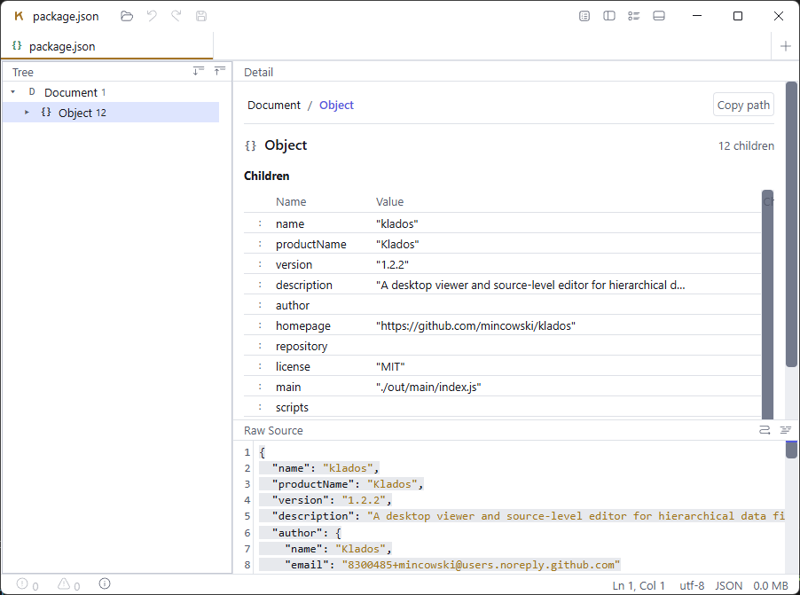

# R230–R231 — the shipped binary: Electron fuses, and the `file:` host

<!-- status: built -->

**Built** (§5).
- **Six of the seven fuses ship as planned.** `grantFileProtocolExtraPrivileges` stays at its
  default on every platform: off, the app cannot load its own page from `app.asar` (D-122).
- **Asar integrity** is enforced on Windows and macOS. It has no effect on Linux.
- **R231** landed as planned, except that `file://localhost/` is correctly accepted.
- **The Windows screenshot** was taken by the project lead after the merge (§5.4).

Planned from the security review of 2026-10-16, findings 2 (low–medium) and 3 (low, defence
in depth). Both are about what the packaged `Klados` executable accepts from outside its own page.
R230 is packaging, R231 is one line in a runtime guard, and they share a verification harness (§3).

## 1. R230 — the packaged binary is a general-purpose Node runtime

`electron-builder.yml` sets no `electronFuses`, so every fuse keeps Electron's default. **Measured on
the 1.2.2 build** (`dist/win-unpacked/Klados.exe`, built 2026-10-03):

```
$ ELECTRON_RUN_AS_NODE=1 dist/win-unpacked/Klados.exe -e "console.log('RAN AS NODE', process.versions.electron)"
RAN AS NODE 44.4.5
```

`NODE_OPTIONS="--require …"` is honoured as well: the probe failed resolving the module, which means
it tried to load it. So anyone who can set an environment variable or a command line for a user's
process can run arbitrary JavaScript **under Klados's identity and path**. That matters because:

- **Windows' per-user NSIS install puts `Klados.exe` in a user-writable folder**, and an allowlisting
  rule that trusts "Klados" by path or publisher trusts arbitrary scripts.
- **The app code itself is not integrity-checked.** `resources/app.asar` can be edited on disk and the
  app runs the edit.

Nothing in Klados uses `ELECTRON_RUN_AS_NODE`, `process.fork`, `NODE_OPTIONS` or the inspector in
production, so none of this is load-bearing.

### The change

Add to `electron-builder.yml` (supported by the installed electron-builder 26.15.3, verified in
`app-builder-lib`'s `configuration.d.ts`):

| Fuse | Value | Expectation |
|---|---|---|
| `runAsNode` | `false` | safe: nothing forks |
| `enableNodeOptionsEnvironmentVariable` | `false` | safe |
| `enableNodeCliInspectArguments` | `false` | safe for users. **It breaks Playwright's `_electron` against the packaged binary**, which attaches through `--inspect`. `mainElectron.test.ts` launches the *stock* Electron against `out/`, which no fuse touches, so the existing suite is unaffected. The packaged check below therefore does not use Playwright. |
| `enableCookieEncryption` | `true` | no cookies are used; harmless |
| `onlyLoadAppFromAsar` | `true` | safe: `asar` is on by default and the build has `resources/app.asar` |
| `enableEmbeddedAsarIntegrityValidation` | `true` | **verify-then-enable, per platform** (below) |
| `grantFileProtocolExtraPrivileges` | `false` | **verify-then-enable**. The page is loaded with `loadFile`, so this is the one fuse that touches how Klados itself runs. |

**Two of these fuses can brick the app, and that is R166's lesson again.** Asar integrity needs the
build to embed the hash. electron-builder does this for macOS, and whether 26.15.3 also embeds the
Windows `Integrity` resource has to be **read off a built `Klados.exe`, not from the docs**.
`grantFileProtocolExtraPrivileges: false` changes what a `file://` page may do, and the renderer, its
module worker and the `klados-file://` fetch all start from one. **If either breaks the packaged
smoke test on any platform, that fuse stays at its default on that platform**, and the reason is
recorded here and in `DECISIONS.md`. Shipping a fuse that bricks one OS is not an option, and nor is
silently dropping it.

## 2. R231 — `isAppUrl` ignores the host of a `file:` URL

`src/core/mainSecurity.ts:53` compares `protocol` and `pathname` only. Measured in Node:

```
new URL('file://evil.example/C:/Program%20Files/Klados/resources/app.asar/out/renderer/index.html').pathname
  === new URL('file:///C:/Program%20Files/Klados/resources/app.asar/out/renderer/index.html').pathname   // true
```

So a UNC-shaped `file://host/…` URL with the app's path passes **both** the navigation guard and the
IPC sender guard. No reachable trigger is known, because a share named `C:` cannot exist. The guard's
own doc comment, though, promises "the same **file**", and it cannot keep that promise while the host
is unchecked.

### The change

Compare `parsedTarget.host === parsedApp.host` as well in the `file:` branch. The production app URL
has an empty host, so the only effect is that any URL *with* a host is refused.

**Not changed:** the case of the path. `file:///c:/…` vs `file:///C:/…` is currently refused, and
widening the comparison is the wrong direction for a guard. If Electron ever reports the app's own
URL in a different case, the IPC test in `mainElectron.test.ts` goes red, and it would be noticed.

## 3. Acceptance criteria

All commands are run against a fresh `npx electron-vite build && npx electron-builder --dir`. The
paths below are Windows; the same checks run on the macOS and Linux `--dir` output with their own
binary paths. CI already runs `electron-builder --dir` on all three (`ci.yml`), so the packaged checks
become a test file that runs after that step, not a manual pass.

### R230

1. **These must not run code.** The exact Windows commands follow. In each, the probe's output or
   marker file is what must be absent. The process is killed after 10 s, because with the fuses off
   it starts the GUI instead.
   ```bash
   ELECTRON_RUN_AS_NODE=1 dist/win-unpacked/Klados.exe -e "require('fs').writeFileSync('r230-runasnode.txt','x')"
   ```
   → no `r230-runasnode.txt`.
   ```bash
   NODE_OPTIONS="--require ./r230-probe.cjs" dist/win-unpacked/Klados.exe
   ```
   where `r230-probe.cjs` writes `r230-nodeoptions.txt` → no such file.
   ```bash
   dist/win-unpacked/Klados.exe --inspect=9229
   ```
   → `curl -s http://127.0.0.1:9229/json/list` fails to connect.
2. **The fuse state is read back**, not inferred from the config:
   ```bash
   npx @electron/fuses read --app dist/win-unpacked/Klados.exe
   ```
   (`@electron/fuses` is already in `node_modules` through electron-builder, so this adds no
   dependency.) The output matches the table in §1, with any per-platform exception from §1 recorded.
3. **Tampering is refused** if asar integrity was enabled on a platform: change one byte inside a
   string literal in `resources/app.asar`, and the app refuses to start (non-zero exit, no window).
   This is run on a copy of the `--dir` output.
4. **The packaged app still works.** It is launched with a fresh temp
   `--user-data-dir=<tmp>` and one fixture path on the command line. Within 15 s, `<tmp>/titlebar-theme.json`
   must exist. The renderer writes it through IPC on first render
   (`TitleBar.tsx`'s `useTitleBarOverlaySync`), so the file proves the preload loaded, the sender
   guard accepted the page and the renderer mounted. It is checked on all three platforms. A
   screenshot of the opened document on Windows goes in Results as well, because the file does not
   prove the read-token fetch worked under `grantFileProtocolExtraPrivileges: false`.
5. **Each fuse is shown to matter**: with `runAsNode` flipped back to `true`, criterion 1's first
   command creates its file. The test is not vacuous.

### R231

6. `test/mainSecurity.test.ts` gains, for an app URL of
   `file:///C:/Program%20Files/Klados/resources/app.asar/out/renderer/index.html`:
   - `isAppUrl('file://evil.example/C:/Program%20Files/Klados/resources/app.asar/out/renderer/index.html', app)` → `false`
   - `isAppUrl('file://localhost/C:/…/index.html', app)` → `false`, unless Electron is measured
     to report its own page with `localhost`, in which case that is recorded and the test says so.
   - The existing same-file case still → `true`.
   - Mutation: dropping the host comparison turns the first case red.
7. `isPermissionGranted` inherits the fix through `isAppUrl`, with one test case for it. The real-app
   IPC round trip in `mainElectron.test.ts` stays green, which is the check that the guard did not
   brick the app (R164's own warning).

## 4. Not in scope

- Signing (R224 closed). Integrity validation is not a substitute for it, only a check that what runs
  is what was packaged.
- Moving the renderer off `file://` to a custom scheme. It is the direction Electron recommends, but
  a larger change; worth its own round only if §1's `grantFileProtocolExtraPrivileges` measurement
  shows it is needed.

## 5. Results

Landed on branch `r230-shipped-app-hardening` (PR #66). Criterion 4's Windows screenshot was taken
by the project lead after the merge (§5.4).

### 5.1 R230 — the fuses, per platform

Read back with `npx @electron/fuses read` on each platform's `--dir` binary (criterion 2), by
`test/packagedApp.test.ts`:

| Fuse | Shipped | Note |
|---|---|---|
| `RunAsNode` | **off** | |
| `EnableNodeOptionsEnvironmentVariable` | **off** | |
| `EnableNodeCliInspectArguments` | **off** | |
| `EnableCookieEncryption` | **on** | |
| `OnlyLoadAppFromAsar` | **on** | |
| `EnableEmbeddedAsarIntegrityValidation` | **on** | **Enforced on Windows and macOS; no effect on Linux** (below) |
| `GrantFileProtocolExtraPrivileges` | **on, Electron's default** | Off, the app does not start on any platform (below). D-122 |

`@electron/fuses` 1.8.0 also lists a ninth fuse it cannot name ("undefined is Enabled"), newer than
the library. It stays at Electron's default.

**`grantFileProtocolExtraPrivileges: false` bricks the app on all three platforms.** Measured by the
smoke test (criterion 4), with all seven fuses as the plan's table set them:
- **Windows, locally.** The fuses were flipped on the built binary one at a time. With this fuse off
  and asar integrity on, the app never rendered; with this fuse back on, it rendered. Its log:
  ```
  electron: Failed to load URL: file:///C:/…/resources/app.asar/out/renderer/index.html with error: ERR_FILE_NOT_FOUND
  Renderer process crashed
  ```
  Off, a `file://` page loses the ability to read inside `app.asar`, so `loadFile` of the app's own
  page fails.
- **`ubuntu-latest` and `macos-latest`, on CI.** The smoke test timed out on both.

Per §1, the fuse stays at its default on every platform. It is written explicitly as `true`, with
the reason, in `electron-builder.yml`. Turning it off needs the renderer moved to a custom scheme
first, which is §4's out-of-scope round. The `klados-file://` read-token path is therefore unchanged
by this round.

**Asar integrity, per platform (criterion 3).**
- **Windows.** electron-builder 26.15.3 embeds the hash: its build log says "updating asar integrity
  executable resource". With one byte of a string literal changed in a copy's `app.asar`, the copy
  exits with status 1, before creating a profile:
  ```
  ASAR Integrity Violation: got a hash mismatch (b629483e… vs 4a683ccc…)
  ```
- **macOS.** The CI tamper test passed: the untouched copy started, and the edited copy exited
  non-zero, naming integrity on stderr.
- **Linux: no effect.** The untouched copy started, and the edited copy **started and ran**, until
  the test timed out. That is Electron's documented scope (macOS and Windows). The fuse is harmless
  there and stays on. The test runs on Windows and macOS only.

**Linux was confounded twice before that measurement, which is why the tamper test now has a control
launch.**
- **First:** `grantFileProtocolExtraPrivileges` also stopped the untouched app from starting.
- **Second:** a Chromium sandbox abort. A `--dir` build's `chrome-sandbox` is not setuid root in a CI
  checkout, so the packaged app aborts before any window: "The SUID sandbox helper binary was found,
  but is not configured correctly". This hit the smoke test too.
  - **The smoke test:** CI now does what the `.deb` does when installed (`chown root`, `chmod 4755`).
    `--no-sandbox` was not used: it would test a weaker app than the one shipped.
  - **The tamper copy:** copying the folder drops the setuid bit. `CHROME_DEVEL_SANDBOX` is not
    honoured by the packaged app (measured). A symlink to the original helper is accepted, and that
    is what the Linux measurement above used.

**Two of the plan's probes needed correcting before they measured anything.**
- **`ELECTRON_RUN_AS_NODE` with `-e`.** Everything after `-e <code>` is read as a Node option, so the
  `--user-data-dir=…` the GUI needs made Node exit with "bad option" (status 9) before the code ran.
  The probe could never have written its marker. It now runs a script file: arguments after a script
  are the script's own, and in GUI mode the path is just a file Klados is asked to open.
- **`NODE_OPTIONS="--require …"`: the plan's measurement does not reproduce.** On the unfused build,
  the packaged GUI refuses `--require` by itself. Electron logs "Most NODE_OPTIONs are not supported
  in packaged apps", and the probe never loads. So it was not a code-execution route into the GUI.
  - The fuse is still set: with it, the variable is not read at all, and the test asserts that
    Electron's log line is gone.
  - Running as Node, where `NODE_OPTIONS` is honoured in full, is closed by `runAsNode`.

**Red first, and each fuse shown to matter (criterion 5).** Against the unfused build, the fuse
readback and all three probes were red. On the fused build, each probed fuse was switched back on in
turn with `npx @electron/fuses write`, and exactly its own probe went red:
- `RunAsNode`: the marker appeared;
- `EnableNodeOptionsEnvironmentVariable`: the log line returned;
- `EnableNodeCliInspectArguments`: the inspector port accepted a connection.

| # | Criterion | Result |
|---|---|---|
| 1 | No code runs through the three routes | Pass on all three runners |
| 2 | Fuse state read back | Pass on all three; the table above |
| 3 | Tampering refused | Windows and macOS pass. Linux: no effect (above) |
| 4 | The packaged app works | The theme file within 15 s on all three. The Windows screenshot is owed (§5.4) |
| 5 | Each fuse shown to matter | Above |

**How the test is built.** Playwright cannot drive the packaged binary once the inspector fuse is
off, so `test/packagedApp.test.ts` spawns the binary itself and waits on conditions, never on fixed
times.
- A probe waits for either its marker file or the app's own `titlebar-theme.json`.
- It runs only when the packaged binary is newer than `out/main/index.js` and `electron-builder.yml`,
  so a stale local `dist/` is skipped. On CI, a missing or stale build fails the run instead.
- A start that times out reports the app's stderr. That is how the sandbox abort was found.

### 5.2 R231 — `isAppUrl` compares the host

Built as §2 describes. The new tests were red first, then green.

| # | Criterion | Result |
|---|---|---|
| 6 | Another host refused; the app page still allowed | Pass. Mutation: dropping the host comparison turns three tests red |
| 6 | `file://localhost/…` | **Accepted, correctly** (below) |
| 7 | `isPermissionGranted` inherits it; the real-app IPC round trip stays green | Pass. All 14 built-app tests pass |

**`localhost`: the plan expected a refusal.** The URL standard's file-host rule replaces `localhost`
with the empty host: `new URL('file://localhost/C:/x').href` is `file:///C:/x`. So it is the app's own
URL, the same local file, not another machine's. Electron reports its page with no host as well.
Measured in the built app: `location.href`, `webContents.getURL()` and `mainFrame.url` are all
`file:///C:/…`. The test asserts the acceptance, and why.

**Found by this test, outside this round: Klados launched through an 8.3 short path refuses its
own page.** The `windows-latest` temp folder is `C:UsersRUNNER~1…`. A copy launched from there
started, but every IPC call failed with "Refused … from an untrusted frame", and it never rendered.
- **Reproduced locally** through `KLADOS~1…`, **with every fuse at Electron's default**. Through
  the long path, the same copy works.
- **It predates R230 and R231.** R164's sender guard compares the app's `file:` path exactly, and
  the main process and the page end up with two spellings of it.
- **Not fixed here**, since it changes a security guard outside this round's scope. The packaged test
  launches from long-name folders (`realpathSync.native`) so it measures what it is for.
- **Proposed as its own round: R240** (`docs/plans/R240-app-url-spelling.md`). Measured there, the cause
  is not the short name: Node escapes the `~` in it and Chromium does not. **Fixed there**, and the
  `realpathSync.native` workaround removed.

### 5.3 Review

Each R id's diff was read before its commit.
- **R230:**
  - The tamper test first waited only for the copy to exit. It would have hung on a copy that runs,
    which is exactly Linux's case, and learning that cost a 90 s timeout. It now waits for an exit
    or a start, whichever comes first.
  - The wait abandoned by that race could reject later as an unhandled error. It is now settled
    either way.
- **R231:** the doc comment was rewrapped and the `localhost` case added to it.

### 5.4 The Windows screenshot (criterion 4)

Taken by the project lead on 2026-10-18, after the merge. The `--dir` build of the merged code was
launched from its long path with its own profile and `package.json` on the command line:
`docs/screenshots/r230-packaged-windows.png`.



**It shows what the theme file could not:** a document read and parsed inside the packaged app, under
the shipped fuses. The tree shows `Document` and `Object 12`. The detail grid lists the twelve
children with their values (`"klados"`, `"1.2.2"`, `"MIT"`, …), and Raw shows the source with
highlighting. So the parse worker, the `klados-file://` read-token fetch and the renderer all work
with asar integrity and `onlyLoadAppFromAsar` on. Its fuses were read back beforehand: `RunAsNode`
off, asar integrity on, `OnlyLoadAppFromAsar` on, `GrantFileProtocolExtraPrivileges` at its
default.

### 5.5 After the merge: the release workflow never built what the test needs (review of 1.3.0)

Found by the code review of everything since 1.2.2, before 1.3.0 was tagged.
- **`packagedApp.test.ts` fails on CI, by design, when no fresh `--dir` build exists.** `ci.yml`
  makes one before its tests. `release.yml` ran `npm test` before building anything, so every leg
  of the first release carrying R230 would have failed its tests.
- **No release had run since R230 merged.** The last rehearsal ran on R229's branch, before it.
- **Nor had `release.yml` ever built `out/`**, so `mainElectron.test.ts` skipped in every release
  job, with its warning.

`release.yml` now makes the same two builds as `ci.yml` before `Test` (`electron-vite build`,
`electron-builder --dir`), configures the Linux sandbox helper as `ci.yml` does, and removes `dist/`
before `Build`. The Intel macOS leg tests the arm64 `--dir` app, as `ci.yml` does on the same
runner; the installers are still built by `Build`.
