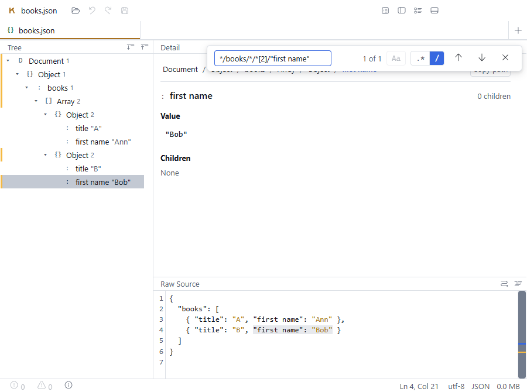

# R242 — Copy path finds the node it was copied from, in every format

<!-- status: built -->

**Built** (§6), for 1.3.0, at the project lead's request. Every node of every format now finds
itself through its copied path, and a name can be quoted (D-126).

Found on 2026-10-21 while checking, for the project lead, what the Detail pane's **Copy path**
button is good for. The copied path is meant to be pasted into the command palette's `/` mode or
into Find's path mode, and to find the node again (R75, D-081). In XML it did. In JSON and CSV it
never did, and in TOML it failed for some nodes. Names containing a space or one of the grammar's
reserved characters could not be written in a path at all.

## 1. What happens today

### 1.1 In the built app

Driven with Playwright against `out/` built from `main` at `1f43443`. The script clicks a tree row,
clicks **Copy path**, opens the palette with Ctrl+Shift+P, pastes with Ctrl+V and presses Enter:

| Document | Node | Copied | Palette | After Enter |
|---|---|---|---|---|
| `garage.xml` | the second `<car>` | `/garage/cars/car[2]` | `Enter to show 1 match` | Find opens in path mode with `garage/cars/car[2]`, `1 of 1`, the second car selected |
| `books.json` | the second book's `title` | `/books/*[2]/title` | `No matches` | Find opens in path mode, `No matches` |
| `books.json` | the second book's `first name` | `/books/*[2]/first name` | `expected '/' or '//' between steps`, under the space | nothing (a query that does not parse cannot be run) |

So the handover itself works: the palette hands its query to Find, and Find switches to path mode
and runs it. The defect is in the copied string.

### 1.2 Every node, every format

For every node of a small document per format, `copyPathFor(pathSegmentsOf(node))`, with its
leading `/` removed as the palette removes it, parsed and evaluated against the same store:

| Format | Finds exactly that node | Finds nothing | Does not parse |
|---|---|---|---|
| XML | 7 of 8 | 1 (a comment) | 0 |
| JSON, an object at the top | 0 of 11 | 9 | 2 |
| JSON, an array at the top | 0 of 8 | 7 | 1 |
| TOML | 9 of 13 | 3 (an array inside a table, and its elements) | 1 (`first name`) |
| CSV | 0 of 3 | 2 | 1 |

(The "does not parse" entries without a space in the name are the top-level value itself, whose
path is `/`, empty once the palette removes its prefix. That case is unchanged by this round: a
path to the document's top is not a query.)

### 1.3 Why

**`toKladosPath` leaves out every unnamed node that is not an array element, and the evaluator
does not.** `isAddressableStep` (`detailModel.ts`) treats two kinds of unnamed node as transparent,
on JSON Pointer's model: the document's own top-level value, and the Object or Array that holds a
JSON property's composite value (D-030's folding). `evaluatePath` walks the store literally: a step
is one level of children. Measured against `{"books":[{"title":"A"},{"title":"B"}]}`:

| Query | Result |
|---|---|
| `books/*[2]/title` (what the palette receives today) | no matches |
| `*/books/*/*[2]/title` | the second `title` |

CSV is the same shape: its rows sit under one unnamed table node, which the copied path leaves
out.

**R75's own round-trip test never evaluated the path.** `test/detail.test.ts` asserts that
`parsePath` accepts `*[3]` for `[10,20,30]`, not that it finds the third element. It does not: the
top-level array is one level below the document, so `*[3]` finds nothing and `*/*[3]` finds it.
This is the "asserting shape, not values" mistake `CLAUDE.md`'s review section names.

**The grammar has no way to write some names.** A name ends at whitespace or at any of
`/ [ ] @ * ( ) = ! < > " '` (`RESERVED_NAME_CHARS`), and nothing quotes or escapes one. JSON keys
and TOML quoted keys can contain any of these, and the empty key `""` is valid JSON. *(Corrected in §6: JSON and TOML store an empty key as no name, so it is addressed by position and needs no quoting.)*

## 2. Decided by the project lead on 2026-10-21

### 2.1 Copy path writes every step

Every node between the document and the selected one becomes a step. A named node is its name,
with `[n]` when siblings share it, as today. **An unnamed node is `*`**, with `[n]` (its position
among all of its parent's children) when its parent has more than one child. `*` matches a child
of any name, so `*[n]` is exactly the node at that position.

| Document | Node | Today | Now |
|---|---|---|---|
| `{"books":[{"title":"A"},{"title":"B"}]}` | second `title` | `/books/*[2]/title` | `/*/books/*/*[2]/title` |
| `[{"t":1},{"t":2}]` | second object | `/*[2]` | `/*/*[2]` |
| `<garage><cars><car/><car/></cars></garage>` | second `car` | `/garage/cars/car[2]` | unchanged |
| CSV, second row | | `/*[2]` | `/*/*[2]` |

**The evaluator does not change**, nor what any query means. JSON paths are longer.

*Rejected:* making the evaluator skip the same unnamed nodes, so that `/books/*[2]/title` works as
written. That changes what every existing JSON query means (`pathEvaluate.test.ts`'s `*/a//*`, for
one), and touches D-030, D-081 and invariant 8's same-query-same-answer claim. Too large for a
release in progress; it can be its own round if the longer paths turn out to matter.

`toXPath` and `toJsonPointer` keep `isAddressableStep`: in their address spaces the unnamed nodes
really are not steps.

### 2.2 A name can be quoted, with a doubled quote inside

A step's name may be written between `"` or `'`, which the grammar already uses for predicate
literals (`[@id="c-001"]`). A quote character inside is written twice, as in XPath 2.0 and SQL:

| Written | Name |
|---|---|
| `"first name"` | `first name` |
| `'unit price'` | `unit price` |
| `"say ""hi"""` | `say "hi"` |
| `"*"` | `*`, a name, not the wildcard |
| `""` | the empty name |

- **Copy path quotes only a name that needs it**: one that is empty or has a character the grammar
  does not allow in a bare name. Every other path is exactly as before.
- **A predicate's subject may be quoted as well** (`*["unit price">3]`, `[@"x y"]`), so a key with
  a space can be filtered on too. A subject never starts with a quote today, so this adds meaning
  only to text that is currently an error.
- **Predicate string literals gain the doubling as well**, through the same `consumeQuotedString`.
  `[@title='it''s']` is a parse error today, so no valid query changes meaning.
- **A `]` inside quotes no longer ends a predicate.** `consumePredicate` scans to the first `]`, so
  `[@id="a]b"]` fails today, and a quoted subject containing `]` would as well. It now skips quoted
  text while looking for the closing bracket.

*Rejected:* backslash escapes (`first\ name`): harder to read, and `\` becomes one more reserved
character.

## 3. The change

- `src/core/path/parse.ts`:
  - `consumeQuotedString` reads a doubled quote as one quote character.
  - A step's name and a predicate's subject may each be quoted. An unterminated quote is a
    diagnostic at its opening quote.
  - `consumePredicate` skips quoted text when looking for `]`.
  - A new `quotePathName(name)` returns the name bare when the grammar can read it bare, and quoted
    otherwise. It lives next to `isNameChar`, so the two cannot disagree.
- `src/renderer/components/Detail/detailModel.ts`:
  - `PathSegment` gains `siblingCount`, counted in the loop `pathSegmentsOf` already runs.
  - `toKladosPath` writes every segment below the document, as §2.1 says, through `quotePathName`.
- `docs/CONCEPT.md` §6.3 gains quoted names.
- A new decision, D-126, amends D-081.

**Cost.** `siblingCount` is the index the existing sibling loop already ends with. Quoting scans a
name once, on a click. The parser change adds one branch where a step or subject starts, and a
quote check in the predicate scan.

## 4. Acceptance criteria

1. **The round trip, over every node:** for every node of a fixture per format (XML with comments
   and repeated names, JSON with an object and with an array at the top, nested arrays and duplicate
   keys, TOML with an array of tables and an array inside a table, CSV), the copied path, with the
   palette's prefix removed, parses and evaluates to **exactly that node**. The top-level value
   (`/`) is the stated exception.
2. **Generated names:** the same holds for keys built from every reserved character, whitespace,
   both quote characters, the empty key, `*`, digits-only and non-ASCII keys.
3. XML paths are unchanged, character for character, for documents without comments (the existing
   `toKladosPath` tests keep passing as written).
4. Quoted steps and subjects parse to the right name, including doubled quotes, `"*"` and `""`.
   An unterminated quote is a diagnostic at the opening quote.
5. `[@id="a]b"]` parses, and `[@title='it''s']` compares against `it's`.
6. Every existing path-grammar test passes unchanged.
7. In the built app: the copied path of the second book's `title` and of its `first name`, pasted
   into the palette, shows `Enter to show 1 match`, and Enter selects that node.

## 5. Not in scope

- Making the evaluator skip unnamed wrapper nodes (§2.1, rejected for now).
- Copying a path to the document's top-level value (`/`).
- Showing the copied path anywhere else in the UI.

## 6. Results

### 6.1 The criteria

| # | Criterion | Result |
|---|---|---|
| 1 | Every node of a fixture per format finds exactly itself | **Pass.** `test/copyPathRoundTrip.test.ts`: XML with comments, processing instructions, text, a namespace prefix and repeated names; JSON with an object, an array and a bare scalar at the top, nested arrays and duplicate keys; TOML with quoted and dotted keys, an array of tables, and arrays and inline tables inside them; CSV with a header holding a space. **The stated exception went away**: the top-level value is now `/*` and finds itself. Only the document node is `/` |
| 2 | Generated awkward names | **Pass.** Keys built from every reserved character, a no-break and an ideographic space, both quote characters, `*`, digits only, `and`, `not`, non-ASCII, an astral character, the empty key and a duplicate, in an object and in an array of two such objects |
| 3 | XML paths unchanged | **Pass.** The existing `toKladosPath` XML tests pass as written. A comment, text or processing instruction under an element is now `*[n]` and found; it found nothing before |
| 4 | Quoted steps and subjects | **Pass.** `test/pathParse.test.ts`, R242 block: both quotes, doubled quotes, `"*"` as a name, `""`, a quoted step with a predicate, quoted child and attribute subjects, a digits-only quoted subject; an unterminated quoted name is reported at its opening quote |
| 5 | `]` in quotes, doubled quotes in literals | **Pass.** `[@id="a]b"]` gives `a]b`; `[@title='it''s']` gives `it's`; an unclosed quote in a predicate is reported at that quote |
| 6 | Existing grammar tests unchanged | **Pass.** `pathParse`, `pathEvaluate`, `pathUnicodeNames`, `pathPredicateBudget` pass without edits. Four `detail.test.ts` tests asserted the old strings; they now assert the new ones, and R75's round-trip test now evaluates the path instead of only parsing it |
| 7 | In the built app | **Pass**, below |

**The round-trip test is measured against the old code**: with `toKladosPath` restored to `main`'s,
all seven of its tests fail, the XML one included (its comments and processing instruction).

### 6.2 In the built app

The same Playwright script as §1.1, against `out/` built from this branch:

| Document | Node | Copied | Palette | After Enter |
|---|---|---|---|---|
| `garage.xml` | the second `<car>` | `/garage/cars/car[2]` | `Enter to show 1 match` | path mode, `1 of 1`, the second car selected |
| `books.json` | the second `title` | `/*/books/*/*[2]/title` | `Enter to show 1 match` | path mode, `1 of 1`, `title "B"` selected |
| `books.json` | the second `first name` | `/*/books/*/*[2]/"first name"` | `Enter to show 1 match` | path mode, `1 of 1`, `first name "Bob"` selected |

### 6.3 What the tests found about names

- **A JSON name is stored as the source spells it**, escapes included: the key `"a\"b"` is the name
  `a\"b`, the same undecoded spelling Klados shows everywhere outside Raw. The copied path quotes that
  spelling (`"a\""b"`) and finds the node; a person typing the decoded `a"b` would not. Not changed
  here.
- **JSON and TOML store an empty key as no name**, so it is `*[n]` like any unnamed node.
  `quotePathName` still quotes an empty name, for a format that ever stores one.

### 6.4 Review

The diff was read before the commit. It found one wrong comment: `quotePathName`'s cited `""` as a
JSON key it would quote, which §6.3 shows never happens. Fixed. Otherwise nothing: `isNameStart`
went with the pre-check it served, `toXPath` and `toJsonPointer` still use `isAddressableStep` and
are unchanged, and `PathSegment`'s new `siblingCount` is the index the existing loop already ends with.
